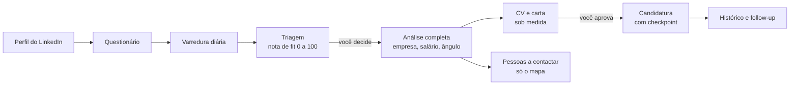

# Radar de Vagas

**Aplicar é fácil. Aplicar bem é raro.**

Uma rotina de busca de emprego que roda no seu computador com o [Claude Code](https://claude.com/claude-code).
Ela varre vagas novas no LinkedIn, dá a cada uma uma nota de fit honesta, aprofunda as
melhores (empresa, salário com fonte, forças e lacunas), gera um CV sob medida em PDF,
mapeia quem contatar na empresa e aplica por você, **sempre parando para você aprovar**.

O espírito: industrializar o cuidado, nunca o spam. Cada vaga recebe o tratamento que um bom
candidato daria em uma tarde, comprimido em minutos, e nada sai sem o seu ok.

> English summary at the end.

## O que ele faz



| Função | Skill | O que entrega |
|---|---|---|
| Coletar seu perfil | `/radar-perfil` | perfil estruturado a partir do export oficial do LinkedIn, e fatos confirmados por você |
| Pôr o Radar no seu contexto | `/radar-configurar` | um questionário de 12 blocos que grava suas preferências |
| Análise de fit | `/radar-triagem`, `/radar-analise` | nota 0 a 100 com justificativa, red flags, mapa de forças e lacunas, ângulo da candidatura |
| Pessoas a contactar | `/radar-pessoas` | recruiter, hiring manager provável e um terceiro nome, com o porquê de cada um (sem escrever mensagem) |
| CV e carta | `/radar-cv` | PDF de 1 página A4 sob medida, com preview e racional das mudanças |
| Aplicação | `/radar-aplicar` | formulário preenchido no navegador, com checkpoint de todas as respostas antes de enviar |

E um **painel local** (http://localhost:8322) onde você decide tudo com um clique: aprofundar,
aprovar, ajustar ou descartar.

## Ver em 3 minutos (sem configurar nada)

```bash
git clone https://github.com/marcos666carv/radar-de-vagas.git
cd radar-de-vagas
bin/radar demo
```

Abre o painel em http://localhost:8323 com dados fictícios (a Ana Souza e empresas
inventadas). Sem nenhuma dependência além do Python 3.10+. Para ver o CV de exemplo em PDF,
instale as dependências antes (próximo passo).

## Instalar

Precisa de: Python 3.10+, [Claude Code](https://claude.com/claude-code), e para aplicar e
mapear pessoas, a extensão Claude in Chrome logada no seu LinkedIn.

```bash
bin/instalar
```

Cria uma venv em `~/.cache/radar-de-vagas/venv` (fora de pastas sincronizadas como Dropbox e
iCloud, que travam venvs), instala `weasyprint` e `pypdf`, confere `pango` e `poppler` e cria
a sua pasta `meus-dados/`. No macOS: `brew install pango poppler`.

## Começar

1. Abra o Claude Code na pasta do projeto.
2. Rode `/radar-configurar`. São 12 blocos curtos (25 a 40 minutos na primeira vez): perfil,
   provas, objetivo, restrições, remuneração, formulários, fit, busca, CV, voz, pessoas e
   rotina. As perguntas estão em [docs/questionario.md](docs/questionario.md).
3. Rode `/radar-triagem` para a primeira varredura e `bin/radar painel` para abrir o painel.
4. Opcional: agende a rotina diária no Claude Code (o `CLAUDE.md` descreve a ordem).

## Como ele pensa

- **[docs/padroes.md](docs/padroes.md)**: as regras de forma de todo conteúdo (fit, CV, carta,
  formulário, links, prazos). É o coração do projeto.
- **[CLAUDE.md](CLAUDE.md)**: a rotina diária, passo a passo.
- **[docs/esquemas.md](docs/esquemas.md)**: o formato de cada arquivo de dados.
- **[docs/linkedin-tecnico.md](docs/linkedin-tecnico.md)**: o que aprendemos sobre o LinkedIn na prática.
- **[docs/design-system.md](docs/design-system.md)**: o visual do painel.

## Seus dados

Tudo que é seu fica em `meus-dados/`, que o `.gitignore` exclui: perfil, fatos, pretensão,
vagas, histórico, CVs. Nada é enviado a lugar nenhum além do que você aprovar (uma
candidatura, por exemplo). O painel é um arquivo local servido só em `127.0.0.1`.

O importador de perfil lê apenas os arquivos de perfil do export do LinkedIn; conexões,
mensagens e convites nunca são abertos.

## Limites e ética

- **Aprovação humana em toda ação pública.** Não existe modo automático de candidatura.
- **Ritmo de pessoa.** A coleta usa o endpoint público de vagas com pausas e para ao primeiro
  sinal de bloqueio. O Radar nunca resolve captcha, cria conta ou digita senha.
- **Verdade documental.** O Radar não inventa nem infla fato: tudo sai do que você confirmou.
- **Use com responsabilidade.** Automatizar o LinkedIn pode contrariar os termos de uso do
  site. Este projeto foi desenhado para o uso de UMA pessoa procurando emprego, em volume
  humano. Você é responsável pelo uso que faz dele.

## Contribuir

Issues e PRs são bem-vindos: veja [CONTRIBUTING.md](CONTRIBUTING.md). Os testes rodam com
`python3 -m unittest discover tests`.

## Créditos

- Rotina, padrões e código: Marcos Carvalho.
- Visual do painel: design system da [Cerol](https://cerol.co).
- Fonte do CV: [Figtree](https://github.com/erikdkennedy/figtree), SIL Open Font License.

Licença MIT (código). A Figtree segue a OFL (ver `templates/fonts/OFL.txt`).

---

## English summary

Radar de Vagas is a local, human-in-the-loop job search routine for Claude Code: it scans
new LinkedIn postings through the public guest endpoint, scores fit from 0 to 100 with an
honest one-line rationale, researches the best matches (company, salary with sources,
strengths and honest gaps), generates a tailored one-page PDF résumé and cover letter, maps
who to contact at the company (without writing messages), and fills applications in your
browser, always stopping for your explicit approval before anything goes out. All your data
stays in `meus-dados/`, which is git-ignored. Try it with `bin/radar demo`. Docs are in
Portuguese; contributions in English are welcome.
